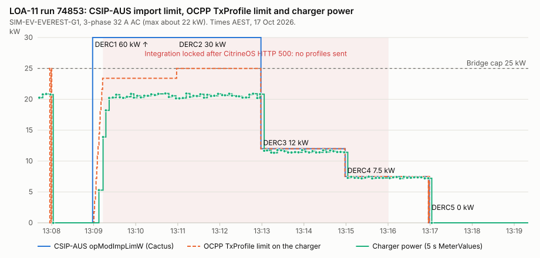
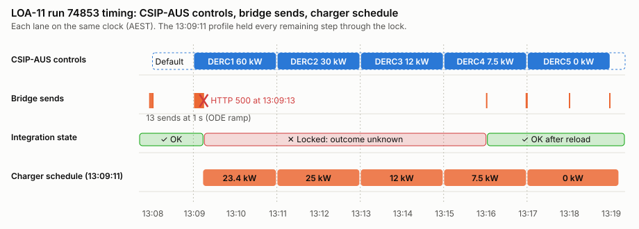
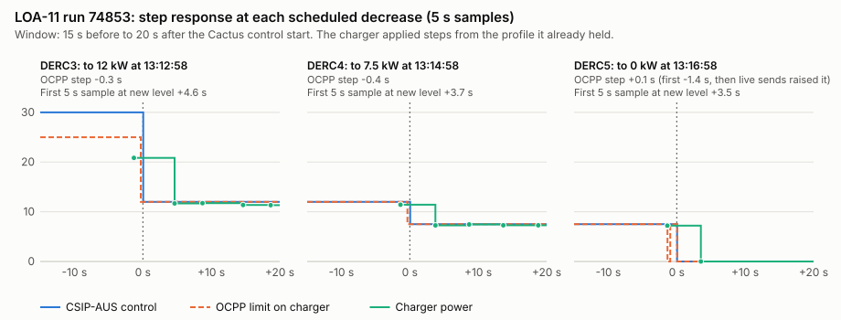
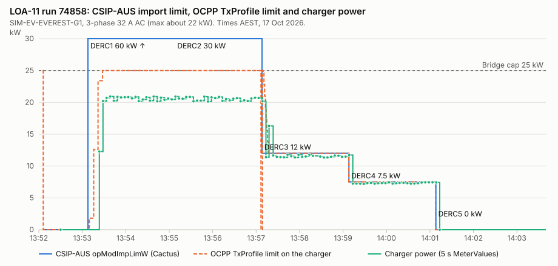
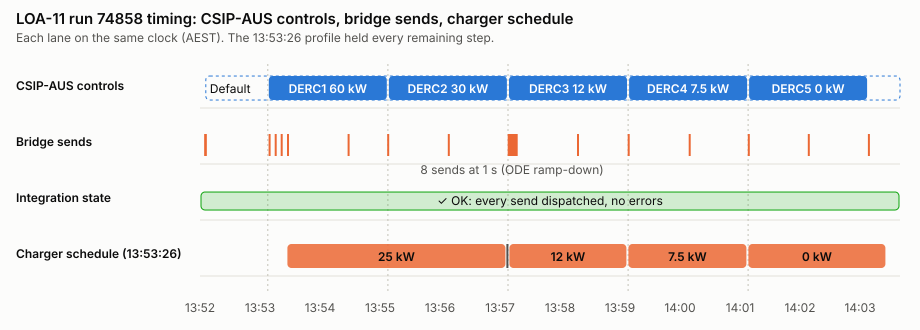
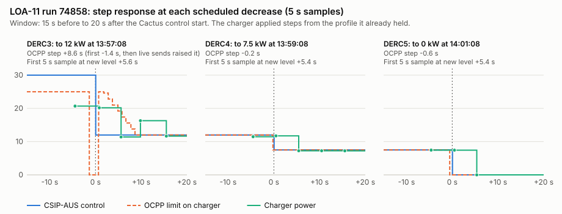

# LOA-11 test report: CSIP-AUS import limits to an OCPP AC charger

Cactus test procedure **LOA-11** (CSIP-AUS v1.2), run twice on 17 October 2026.
Open Dynamic Export (ODE) was the CSIP-AUS client. A Home Assistant bridge
turned ODE's import limit and schedule into OCPP 2.1 TxProfiles, which
CitrineOS sent to the EVerest AC test charger.

| Run | Time (AEST) | Cactus criteria | Bridge |
|---|---|---|---|
| [74853](#run-74853) | 13:07–13:17 | 15 of 16. DERC5 completed missing: run finalised before DERC5 ended | Locked for 6 min 47 s after a CitrineOS HTTP 500; the charger followed the profile it already held |
| [74858](#run-74858) | 13:52–14:03 | **16 of 16** | No errors. Every step on time, except at DERC3, where ODE's ramp-down was re-sent above the held 12 kW step for about 8 s (fixed since) |

Times are AEST (UTC+10) unless marked UTC.

## Set-up (both runs)

```
Cactus (CSIP-AUS v1.2 server)
  └─ Open Dynamic Export 0.1.2 (v0.20.0 + ramp-tms, influxdb-quiet, stdout-log-level patches)
       └─ MQTT limits/csipAus (about 1 message per second)
            └─ HA automation "Lab: ODE schedule to AC EVerest (prototype v2)" (schedule-ahead bridge)
                 └─ citrine_ha service lab_schedule (0.3.3 for run 74853, 0.3.4 for run 74858)
                      └─ CitrineOS Isolated Lab 0.5.3 (OCPP 2.1, lab policy ≤ 25 kW, ≤ 600 s, ≤ 10 periods)
                           └─ EVerest OCPP 2.1 Test Charger 0.1.4: SIM-EV-EVEREST-G1, 3-phase, 32 A (about 22 kW maximum)
```

- The bridge sends one TxProfile per update. Period 0 is ODE's current limit,
  already ramped by ODE. Later periods are ODE's scheduled CSIP-AUS controls
  for the next 600 s. The bridge caps limits at 25 kW and uses
  `numberPhases: 3`.
- The bridge sends when the current limit moves by more than 200 W or 5 %,
  falls by more than 50 W, or the future steps change. Otherwise it resends
  every 60 s.
- The charger sends transaction MeterValues every 5 s
  (`tx_sample_interval_s: 5`), so power readings have 5 s resolution.

## Run 74853

### Result

| Check | Result |
|---|---|
| Cactus criteria | **15 of 16 passed.** Failed: "No responses of type EVENT_COMPLETED (3) found for tag DERC5". |
| Cactus preconditions | Both passed (end-device contents, DER settings contents). |
| Charger followed each import-limit step | **Yes.** Every decrease reached the charger before the Cactus control started, and the first 5 s meter sample after each step was at the new level. |
| Bridge stayed healthy for the whole run | **No.** CitrineOS returned HTTP 500 at 13:09:13. The integration then refused all commands until it was reloaded at 13:16:00. The charger kept to the schedule it already held. |

**Why DERC5 completed is missing.** DERC5 ran from 13:16:58.8 to 13:18:58.8.
The run was finalised at 13:17:25, 93 s before DERC5 ended. ODE sent DERC5
received (1) and started (2) at 13:16:58.5; Cactus accepted both. There was no
completed (3) response because the control had not completed. The previous
LOA-11 run failed the same way: its completed response got HTTP 404 because the
run had already closed. The run summary shows "1/1 steps complete" once the
controls are fetched. **Finalise only after the last control's end time.**

### CSIP-AUS schedule from Cactus (raw)

The raw responses are in [`data/74853/csip-aus-dderc.xml`](data/74853/csip-aus-dderc.xml)
(DefaultDERControl) and [`data/74853/csip-aus-derc.xml`](data/74853/csip-aus-derc.xml)
(DERControlList). They are copied from the Cactus runner's request log and
pretty-printed, otherwise unchanged. All five controls were created at
13:08:58.4 and fetched by ODE at 13:08:59.1.

| Control | `interval.start` (exact start, from `description`) | Duration | `opModImpLimW` (raw) | Watts |
|---|---|---|---|---|
| Default | first served 13:07:59.5 | n/a | value 0, multiplier 0; also `opModExpLimW` 0; `setGradW` 600 | 0 |
| DERC1 | 1792206538 (13:08:58.431) | 120 s | value 6000, multiplier 1 | 60,000 |
| DERC2 | 1792206658 (13:10:58.602) | 120 s | value 30000, multiplier 0 | 30,000 |
| DERC3 | 1792206778 (13:12:58.692) | 120 s | value 12000, multiplier 0 | 12,000 |
| DERC4 | 1792206898 (13:14:58.744) | 120 s | value 7500, multiplier 0 | 7,500 |
| DERC5 | 1792207018 (13:16:58.788) | 120 s | value 0, multiplier 0 | 0 |

The values are multiples of the site's `setMaxW`/maximum import of 30 kW:
DERC1 2×, DERC2 1×, DERC3 0.4×, DERC4 0.25×, DERC5 0. `setGradW` 600 means
6 % of `setMaxW` per second, which is 1.8 kW/s. ODE ramped at this rate
(1,810 W at 13:09:00.4, 23,400 W at 13:09:12.8).

Excerpt (DERC3):

```xml
<DERControl href="/envoy/edev/1/derp/1/derc/1792206448" replyTo="/envoy/edev/1/rsps/site_control/rsp" responseRequired="03">
  <mRID>30000000000000006ad2e67000000000</mRID>
  <description>2026-10-17T13:12:58.692213+10:00</description>
  <interval>
    <duration>120</duration>
    <start>1792206778</start>
  </interval>
  <DERControlBase>
    <csipaus:opModImpLimW>
      <multiplier>0</multiplier>
      <value>12000</value>
    </csipaus:opModImpLimW>
  </DERControlBase>
</DERControl>
```

### OCPP charging profiles sent to the charger

All profiles are in
[`data/74853/ocpp-charging-profiles.json`](data/74853/ocpp-charging-profiles.json), as
the charger received them; each one was answered `Accepted`. Every value the
bridge sent is in [`data/74853/bridge-sends.csv`](data/74853/bridge-sends.csv). That file
includes the start-up sends, which have aged out of the charger's ten-entry log.

This is the last profile before the integration locked. It held every remaining
LOA-11 step, and the charger followed it for the next seven minutes:

```json
{
  "evseId": 1,
  "chargingProfile": {
    "id": 9001, "stackLevel": 1,
    "chargingProfilePurpose": "TxProfile", "chargingProfileKind": "Absolute",
    "transactionId": "b0fb93af-c963-4a47-99de-ca04d9b71f53",
    "chargingSchedule": [{
      "id": 9001, "startSchedule": "2026-10-17T03:09:11.354+00:00", "duration": 600,
      "chargingRateUnit": "W",
      "chargingSchedulePeriod": [
        {"startPeriod": 0,   "limit": 23400, "numberPhases": 3},
        {"startPeriod": 107, "limit": 25000, "numberPhases": 3},
        {"startPeriod": 227, "limit": 12000, "numberPhases": 3},
        {"startPeriod": 347, "limit": 7500,  "numberPhases": 3},
        {"startPeriod": 467, "limit": 0,     "numberPhases": 3}
      ]
    }]
  }
}
```

#### CSIP-AUS control vs OCPP period

| Control | CSIP-AUS start | OCPP period (13:09:11.354 + `startPeriod`) | OCPP limit | Difference |
|---|---|---|---|---|
| DERC1 (live, ramped) | 13:08:58.431 | period 0 of each profile, 13:09:00.4 to 13:09:12.8 | 1,810 → 23,400 W | ramp follows ODE |
| DERC2 | 13:10:58.602 | +107 s = 13:10:58.354 | 25,000 W (capped from 30,000) | −0.25 s |
| DERC3 | 13:12:58.692 | +227 s = 13:12:58.354 | 12,000 W | −0.34 s |
| DERC4 | 13:14:58.744 | +347 s = 13:14:58.354 | 7,500 W | −0.39 s |
| DERC5 | 13:16:58.788 | +467 s = 13:16:58.354 | 0 W | −0.43 s |
| DERC5 (13:16:00 profile) | 13:16:58.788 | 13:15:59.406 + 58 s = 13:16:57.406 | 0 W | −1.38 s |

OCPP periods start on whole seconds from `startSchedule`, so the bridge rounds
each boundary down. Decreases therefore land up to about 1.4 s early, which is
the safe direction for an import limit.

### Charts







### Timing

The charger's response is measured from its 5 s meter samples. A response
faster than 5 s shows up as "next sample".

| Event | CSIP-AUS time | Limit change on the charger | First meter sample at the new level |
|---|---|---|---|
| Default 0 W | 13:07:59.5 | 13:08:00.1, live send (+0.6 s) | 13:08:02.4: 0 W |
| DERC1 60 kW | 13:08:58.4 | ODE ramp sends from 13:09:00.4 (+1.9 s) | 13:09:07.5: 5.3 kW; 20.2 kW (charger maximum) at 13:09:22.2 |
| DERC2 30 kW | 13:10:58.6 | 25 kW from the held profile, 13:10:58.4 | no change: already at its maximum (about 20.5 kW) |
| DERC3 12 kW | 13:12:58.7 | 13:12:58.4 from the held profile (−0.3 s) | 13:13:03.3: 11.7 kW (+4.6 s) |
| DERC4 7.5 kW | 13:14:58.7 | 13:14:58.4 from the held profile (−0.4 s) | 13:15:02.5: 7.3 kW (+3.7 s) |
| DERC5 0 W | 13:16:58.8 | 13:16:57.4 (−1.4 s); back to 7.5 kW from 13:16:57.8 to 13:16:58.8; 0 W from 13:16:58.8 (+0.1 s) | 13:17:02.3: 0 W (+3.5 s) |
| DERC5 end, default 0 W | 13:18:58.8 | 0 W held (resent every 60 s) | 0 W |

Measured power sits 2 to 4 % below each watt limit (for example 11.4–11.8 kW
against 12 kW). The simulator's validation record shows the same offset.

### Findings

1. **CitrineOS HTTP 500 locked the integration for 6 min 47 s.** It happened
   at 13:09:13, during ODE's ramp, when the bridge was sending a profile every
   second. `citrine_ha` treats any failed command as `outcome_unknown` and
   refuses further commands until the integration is reloaded. That is the
   right default for a timeout, but too strict for a definite error reply. The
   charger held the 13:09:11 profile throughout, so every step still happened
   on time. Without a reload, that profile would have expired at 13:19:11 and
   the charger would have returned to 32 A whatever CSIP-AUS required.
   CitrineOS logged no error for the request, so the cause is not confirmed.
   An earlier run that also sent about once a second logged unique-constraint
   errors in `ChargingSchedules` (`id` 9001, same station), which points to
   overlapping profile writes.
2. **One profile briefly undid DERC5 for about 1 s.** The 13:16:57.8 profile
   left out the DERC5 start, which was 1 s ahead, because the bridge skips
   boundaries less than 1 s away. That profile set 7.5 kW until 13:18:57,
   replacing the 13:16:00 profile that had already stepped to 0 W at 13:16:57.4.
   The next update at 13:16:58.8 set 0 W. The 5 s meter samples did not catch
   any effect.
3. **ODE's start-up flicker reached the charger.** At 13:07:55–13:08:00, while
   ODE started, the bridge sent 25 kW, 0, 25 kW and 0. Each was a correct copy
   of ODE's output at the time.
4. **The default control stops charging.** The LOA-11 default is
   `opModImpLimW` 0, so the charger correctly sat at 0 W between controls and
   after DERC5. The transaction stayed open.
5. **Future periods are steps, not ramps.** The bridge does not apply
   `setGradW` to scheduled periods. For the decreases here, stepping early is
   conservative. A scheduled increase would exceed the ramp rate. In this run
   the only scheduled increase (DERC2) was above the cap, and the charger was
   already at its maximum.
6. **DERC1 (60 kW) is above both the bridge cap and the charger's maximum.**
   The bridge sent 25 kW at most; the charger drew about 20.5 kW, its 32 A
   3-phase maximum.

### Changes made after this run

- **Bridge** (HA automation on the lab Home Assistant, 17 Oct 2026):
  - Rises of more than 200 W or 5 % are sent at most every 5 s. Decreases,
    schedule changes and the 60 s refresh still go at once (finding 1).
  - Boundaries less than 1 s ahead are kept. Decreases round down; increases
    round up, so an increase never starts early. Boundaries in the same second
    merge (finding 2).
- **Stall alert** (new automation "Lab: ODE bridge stall alert"): a persistent
  notification when the lab command state stays `outcome_unknown` or
  `dispatch_not_confirmed` for 60 s, or when no profile has been sent for 90 s
  during a session. It clears on the next successful send.
- **`citrine_ha` 0.3.4**
  ([purcell-lab/CitrineOS-HA-Integration#7](https://github.com/purcell-lab/CitrineOS-HA-Integration/pull/7)):
  any 4xx, and HTTP 500 to a schedule, now count as `rejected`, not as an
  unknown outcome, so they no longer block the next command. Timeouts,
  transport errors, 502–504, and 500 to start or stop still block until
  reconciled.

### Limits of this evidence

- Power has 5 s resolution (CitrineOS MeterValues via `citrine_ha`). Charger
  response times shorter than that are not measured.
- ODE's per-second limit log did not keep the run (the App log keeps only
  recent lines). ODE's limit is shown through the bridge's sends, which record
  it at each send.
- The charger's message log keeps the ten most recent profile requests per
  query. Profiles from 13:07:55 to 13:09:02 are recorded in
  `bridge-sends.csv` as their period-0 limit only.
- Cactus, Home Assistant and the simulator each use their own clock (all
  NTP-synchronised). Sub-second differences between sources are approximate.

### Files

| File | Content |
|---|---|
| `data/74853/csip-aus-dderc.xml`, `data/74853/csip-aus-derc.xml` | Raw CSIP-AUS DefaultDERControl and DERControlList from Cactus |
| `data/74853/ocpp-charging-profiles.json` | SetChargingProfile requests received by the charger, with replies |
| `data/74853/bridge-sends.csv` | Every limit the bridge sent, including the failed send |
| `data/74853/charger-power.csv` | Charger power from CitrineOS MeterValues (5 s) |
| `charts/74853/*.svg` | Charts, generated by `python3 make_charts.py` (standard library only) |

The full Cactus artifact set (including the Envoy database dump) is not
committed: it holds site identifiers such as the NMI and LFDI.

## Run 74858

Run 13:52:54 to 14:12:15 AEST (initialised 13:48:35). Same chain as run 74853,
with the changes listed under run 74853 in place: `citrine_ha` 0.3.4, ramp
rises sent at most every 5 s, boundaries less than 1 s ahead kept, and the
stall alert. Before the run, the bridge's default-learning rule was also fixed:
it stored 25 kW as the default when it saw the 0.1 s gap between two
back-to-back controls. It now learns a default only when no control is active
within 2 s either side.

### Result

| Check | Result |
|---|---|
| Cactus criteria | **16 of 16 passed**, including DERC5 completed (sent 14:03:08.6; the run was finalised at 14:12:15). |
| Cactus preconditions | Both passed. |
| Cactus responses | All 15 DERControl responses for the run were accepted (HTTP 201). One earlier response, at 13:50:57, got HTTP 400: ODE answering a control from the previous run before this one started. |
| Bridge | **No errors.** 24 profiles sent and dispatched; the integration never left the dispatched state and the stall alert never fired. |
| Charger followed each step | **Yes, with one exception.** At DERC3 the limit was raised above the 12 kW control for about 8 s (finding 2). |

### CSIP-AUS schedule from Cactus (raw)

[`data/74858/csip-aus-derc.xml`](data/74858/csip-aus-derc.xml) and
[`data/74858/csip-aus-dderc.xml`](data/74858/csip-aus-dderc.xml). The
controls are the same as run 74853: created together, starting now and then
every 120 s. The default is again `opModImpLimW` 0, `opModExpLimW` 0
and `setGradW` 600.

| Control | Exact start | Duration | `opModImpLimW` | Watts |
|---|---|---|---|---|
| DERC1 | 13:53:07.768 | 120 s | 6000 × 10¹ | 60,000 |
| DERC2 | 13:55:07.911 | 120 s | 30000 × 10⁰ | 30,000 |
| DERC3 | 13:57:08.006 | 120 s | 12000 × 10⁰ | 12,000 |
| DERC4 | 13:59:08.060 | 120 s | 7500 × 10⁰ | 7,500 |
| DERC5 | 14:01:08.112 | 120 s | 0 × 10⁰ | 0 |

DERC2 ends at 13:57:07.911, 0.095 s before DERC3 starts. Under CSIP-AUS the
default (0 W) applies in between.

### OCPP charging profiles

The charger's message log keeps only the ten most recent requests, so the
full profiles in [`data/74858/ocpp-charging-profiles.json`](data/74858/ocpp-charging-profiles.json)
are those read during the run: start-up and the DERC1 ramp. Every send is in
[`data/74858/bridge-sends.csv`](data/74858/bridge-sends.csv) with its period-0
limit and the schedule signature it carried (`absolute second:limit` for each
boundary). The charts rebuild the other profiles from these, rounding as the
bridge does.

The profile the charger held from 13:53:27, with every remaining step:

| Period | `startPeriod` | Absolute (AEST) | Limit | CSIP-AUS |
|---|---|---|---|---|
| 0 | 0 | 13:53:26.4 | 25,000 W | DERC1 (60 kW, capped) |
| 1 | 220 | 13:57:06.4 | 0 W | default gap after DERC2 (DERC2's 30 kW is above the cap, so no step at its start) |
| 2 | 222 | 13:57:08.4 | 12,000 W | DERC3 13:57:08.006 (+0.4 s, increase rounded up) |
| 3 | 341 | 13:59:07.4 | 7,500 W | DERC4 13:59:08.060 (−0.7 s) |
| 4 | 461 | 14:01:07.4 | 0 W | DERC5 14:01:08.112 (−0.7 s) |

### Charts







### Timing

| Event | CSIP-AUS time | Limit on the charger | First 5 s meter sample at the new level |
|---|---|---|---|
| Default 0 W | before the run | 0 W from 13:52:06 (after a 25 kW start-up flicker at 13:52:05) | 0 W |
| DERC1 60 kW | 13:53:07.8 | ramp sends 1.8, 12.6, 23.4, 25 kW at 13:53:09.6, 15.7, 21.7, 28.0 | 12.3 kW at 13:53:23.5; 20.2 kW (charger maximum) at 13:53:28.6 |
| DERC2 30 kW | 13:55:07.9 | 25 kW (cap) | no change: already at its maximum |
| DERC3 12 kW | 13:57:08.0 | 0 W from 13:57:06.4, 12 kW from 13:57:08.4 (held); 25 kW from 13:57:08.7, then 24.6 → 12 kW one per second until 13:57:16.7 (live) | 11.4 kW at 13:57:13.6, **16.3 kW at 13:57:17.8**, 11.7 kW at 13:57:23.5 |
| DERC4 7.5 kW | 13:59:08.1 | 13:59:07.4 (held, −0.7 s) | 7.2 kW at 13:59:13.5 (+5.4 s) |
| DERC5 0 W | 14:01:08.1 | 14:01:07.4 (held, −0.7 s) | 0 W at 14:01:13.5 (+5.4 s) |
| DERC5 end, default 0 W | 14:03:08.1 | 0 W held (resent every 60 s) | 0 W |

### Findings

1. **The ramp throttle worked.** DERC1's ramp went out as four profiles over
   18 s, instead of thirteen at 1 s in run 74853. CitrineOS returned no
   errors in this run.
2. **ODE's ramp-down was re-sent above a step the charger already held.**
   The held profile stepped to 12 kW at DERC3. At 13:57:08.7, though, a
   schedule-change send carried ODE's live limit, still 25 kW because ODE
   ramps decreases at `setGradW` too. The following one-per-second
   decreases walked it down to 12 kW by 13:57:16.7. The charger went 11.4 kW,
   then **16.3 kW**, then 11.7 kW, so it was above the 12 kW control at the
   13:57:17.8 sample. **Fixed after the run:** period 0 is now
   min(ODE's ramped limit, the active control's own value). A ramp can still
   slow a rise, but cannot hold the limit above a lower control.
3. **The 0.095 s default gap became 2 s at 0 W.** Decreases round down and
   increases round up to whole seconds, so the gap between DERC2 and DERC3
   was held as 13:57:06.4–13:57:08.4. The 5 s samples do not show it. It is
   within the limit, but a real EV would see a 2 s pause.
4. **ODE's start-up flicker** sent 25 kW for 0.6 s at 13:52:05, as in run
   74853, before ODE fetched the 0 W default.
5. **Responses.** ODE's started and completed responses reached Cactus
   0.5–0.6 s after each control boundary (Envoy log). DERC1 started took 1.7 s,
   because DERC1 began before ODE fetched it. DERC5 completed was accepted
   because the run was finalised after DERC5 ended.

### Limits of this evidence

As for run 74853. In addition, most OCPP profiles in this run are rebuilt
from the bridge's recorded sends rather than read from the charger's log.
The rebuilt boundaries are accurate to about ±0.2 s.

### Files

| File | Content |
|---|---|
| `data/74858/csip-aus-dderc.xml`, `data/74858/csip-aus-derc.xml` | Raw CSIP-AUS DefaultDERControl and DERControlList from Cactus |
| `data/74858/ocpp-charging-profiles.json` | SetChargingProfile requests read from the charger during the run (start-up and DERC1 ramp) |
| `data/74858/bridge-sends.csv` | Every send with its period-0 limit and schedule signature |
| `data/74858/charger-power.csv` | Charger power from CitrineOS MeterValues (5 s) |
| `charts/74858/*.svg` | Charts, generated by `python3 make_charts.py` |
