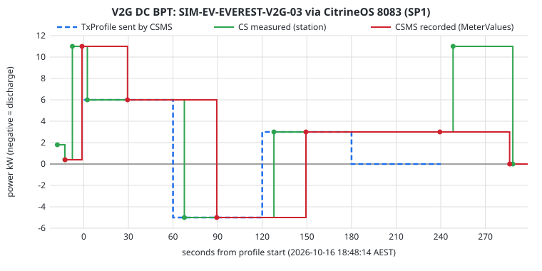
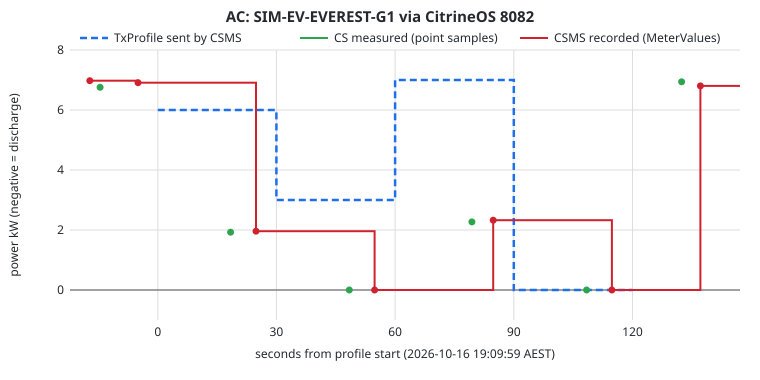
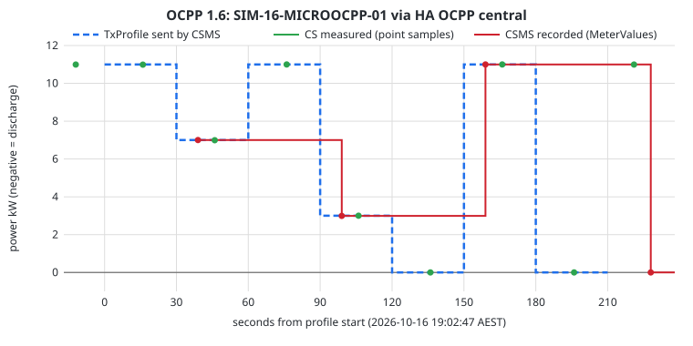

# OCA Plugfest (October 2026): CSMS preparation

Purcell is a **CSMS under test**. This folder holds the lab configuration,
localhost end-to-end test records and findings from the run on the
**Green** test box (HA OS, aarch64) on 16 October 2026.

| Slot | Station under test with us |
|---|---|
| 1 | OCTT (DNV) |
| 2 | EVX Australia |
| 5 | EVSE |
| 6 | Trialog |
| 7 | AS Jade CS (online) |
| 10 | Starcharge |

Decisions: Green on the venue LAN, **Security Profile 1 (Basic Auth over
`ws://`) only**, a provisioned password per station. Procedures are in
`docs/plugfest-runbook.md` on `claude/plugfest-sp1`.

## Contents

| Path | What |
|---|---|
| `README.md` | Configuration notes, test records, findings |
| `data/*.json` | Raw records for each run: the profile sent, station samples, CSMS samples |
| `charts/*.svg` | TxProfile sent versus power measured by the station (CS) and recorded by the CSMS |
| `make_charts.py` | Regenerates the charts from `data/` (standard library only): `python3 make_charts.py` |

## Lab topology

```
                       Green (HA OS, aarch64, 192.168.86.90)
 ┌───────────────────────────────────────────────────────────────────────┐
 │ CitrineOS lab stack (branch store 31ac84d3 = claude/green-e2e)        │
 │   database ─ broker ─ hasura ─ server 0.4.0 (CitrineOS v2.0.1)        │
 │      8082  SP0 open admission (internal only)  ◄── EVerest AC  G1     │
 │      8083  SP1 Plugfest, provisioned only      ◄── EVerest V2G -03 ◄──┼── LAN (host port 8083
 │      8080  gateway (Bearer) ◄── CitrineOS-HA integration              │    only during a slot)
 │                                                                       │
 │ HA OCPP integration "sim_lab_16" (central, port 19002)                │
 │                                                 ◄── MicroOCPP 1.6     │
 └───────────────────────────────────────────────────────────────────────┘
```

## Configuration notes

Secrets aren't recorded here. The lab tokens and the V2G Basic Auth
password were generated for this test only. **Rotate them before the event.**

### CitrineOS lab server (`31ac84d3_citrineos_server` 0.4.0, branch `claude/green-e2e`)

| Option | Value | Note |
|---|---|---|
| `mode` | `isolated` | |
| `open_admission_enabled` | `true` | 8082 stays internal; it is never published on the host |
| `command_control_enabled` | `true` | Scoped commands for `command_station_id` only (#40) |
| `command_station_id` | `SIM-EV-EVEREST-V2G-03`, then `SIM-EV-EVEREST-G1` | Switching needs a server restart and an integration reload |
| `plugfest_enabled` | `true` | Adds the 8083 SP1 listener; unknown stations are rejected |
| `plugfest_stations` | `[{id: SIM-EV-EVEREST-V2G-03, password: <32 hex>}]` | At the event: one entry per vendor station ID |
| Host port `8083/tcp` | `8083` during the test, then `null` | Publish only for the slot; never port-forward to the internet |

The seed provisions each Plugfest station (ChargingStations row, Boots
`Accepted`, `SecurityCtrlr.BasicAuthPassword`) and revokes the password of
any station removed from the list on the next start.

### CitrineOS-HA integration (entry "CitrineOS Green Lab")

`api_profile: v2_scoped_lab_control`, `read_only: false`, `scan_interval: 5`,
with a command token. Entities exist only for the current command station
(#40).

### HA OCPP integration (entry `sim_lab_16`)

Central system on port 19002. Stations connect to the HA Core address
`ws://172.30.32.1:19002`. Use an IP, not a hostname, for MicroOCPP (#38).
Default `MeterValueSampleInterval` is 60 s. Set it lower before a slot
(#42).

### Charging station simulators

| CS | App | CSMS | Key options |
|---|---|---|---|
| **V2G** DC BPT, `SIM-EV-EVEREST-V2G-03` | `everest_v2g_simulator` 0.1.6 (jlink JRE) | CitrineOS **8083 SP1**, via the LAN address `ws://192.168.86.90:8083` | `ocpp_version 2.1`, `max_power_kw 11`, `ha_control true`, `csms_basic_auth_password` (32 hex) |
| **AC**, `SIM-EV-EVEREST-G1` | `everest_simulator` 0.1.1 | CitrineOS **8082** `ws://31ac84d3-citrineos-server:8082` | `ocpp_version 2.1`, `phases 1`, `max_current_a 32` |
| **MicroOCPP 1.6**, `SIM-16-MICROOCPP-01` | `microocpp_simulator16` 0.1.1 | **HA OCPP** central `ws://172.30.32.1:19002` | — |

V2G -03 connects through the host's LAN address, the same path a vendor
charger at the venue will use. It proves the published 8083 port, Basic
Auth and the provisioning end to end.

The MicroOCPP **2.0.1** App (`SIM-MICROOCPP-G1`) couldn't be used. It can't
resolve Supervisor hostnames (#38), and the destination binding refuses a
change to an IP address without a data reset (#29). It is stopped. MicroOCPP
1.6 is the MicroOCPP record below.

## Test records

All times are AEST (UTC+10) on 16 October 2026. In the charts, "CS
measured" is the station's own power reading and "CSMS recorded" is the
power the CSMS stored from MeterValues, as shown in HA.

### 1. V2G: EVerest DC BPT via CitrineOS Plugfest listener (8083, SP1)



| Step | Result |
|---|---|
| Connect | `ws://192.168.86.90:8083/SIM-EV-EVEREST-V2G-03`, security profile 1, negotiated **ocpp2.1**, BootNotification **Accepted** (18:44:59) |
| Unknown station ID on 8083 | WebSocket upgrade refused, **HTTP 404** ✓ |
| Provisioned ID without credentials | Refused, **HTTP 401** ✓ (the CI probe also covers a wrong password and a revoked station) |
| Plug in (HA event `everest_v2g_command`) then Start (CitrineOS-HA) | RequestStartTransaction authorised, ISO 15118-20 TLS session, **DC_BPT**; transaction `988411e5-742c-4a13-84ba-4ecbe6839ef1` |
| TxProfile (`citrine_ha.lab_schedule`) | Absolute, CentralSetpoint **+6 / −5 / +3 / 0 kW**, 60 s each; **Accepted** 18:48:14 |
| Station response | +6 kW at +2 s, −5 kW at +67 s, +3 kW at +128 s ✓. **0 kW: held +3 kW** ✗ (#27); back to 11 kW when the profile expired |
| CSMS view | Same values, on a 30 s grid, up to 30 s after the station (#41) |
| Energy (CSMS) | Import 0.369 kWh, **export 0.080 kWh** (−5 kW × 60 s = 0.083 kWh ✓) |
| Stop, unplug, clear | Stop accepted, transaction closed (HA saw it about 30 s later, #41), ClearChargingProfile dispatched |
| Connector status in HA | `Unknown` throughout ✗ (#37) |
| Memory | V2G App up to 370 MB; CitrineOS server 268 MB |

### 2. AC: EVerest via CitrineOS (8082)



| Step | Result |
|---|---|
| Connect | 8082, **ocpp2.1**, connector status Available → Occupied → Available in HA ✓ |
| Plug in (App UI API) then Start (CitrineOS-HA) | Authorised; transaction `742041fc-6d83-4b9b-b5b6-a81f01f6e472`; 6.9 kW (32 A single phase) |
| TxProfile | Absolute, **6 / 3 / 7 / 0 kW**, 30 s each, W; **Accepted** 19:09:55.4 (172 ms) |
| Station response | **1.93 / 0 / 2.27 / 0 kW** ✗. libocpp assumes 3 phases when `numberPhases` is absent, and the lab command path can't send it (#39). 0 kW paused correctly ✓; back to 6.9 kW after expiry |
| CSMS view | Matches the station, on a 30 s grid (#41) |
| Energy | Station 126 Wh at 19:12:12; CSMS 0.129 kWh at stop and 0.134 kWh final ✓ |
| Stop, unplug, clear | Closure seen in HA 30 s after the stop (#41); profile cleared |

### 3. MicroOCPP 1.6 via HA OCPP central



| Step | Result |
|---|---|
| Connect | HA OCPP central, OCPP 1.6J, heartbeat current |
| Plug in (simulator API `/api/connector/1/evse`) then `switch.charger_charge_control` on | RemoteStartTransaction; transaction **1792141346**; 11 kW |
| TxProfile (`ocpp.set_charge_rate` with `custom_profile`) | TxProfile, Absolute, W, **11 → 7 → 11 → 3 → 0 → 11 → 0 kW**, 30 s each; received 19:02:41 |
| Station response | **10.99 / 6.99 / 11.00 / 3.00 / 0 / 11.00 / 0 kW** ✓, every step including both 0 kW pauses; back to 11 kW after expiry |
| CSMS view | Only every 60 s (7.0, 2.99, 11.0 kW): the 0 kW steps are invisible ✗ (#42) |
| Energy | Station 463 Wh, HA session 0.449 kWh ✓; HA import register `unknown` (#42) |
| Stop and unplug | Charge control off → Finishing; unplugged |

### Summary

| Check | V2G (8083 SP1) | AC (8082) | MicroOCPP 1.6 (HA OCPP) |
|---|---|---|---|
| Connect and boot | ✓ 2.1 | ✓ 2.1 | ✓ 1.6 |
| Remote start | ✓ | ✓ | ✓ |
| TxProfile accepted | ✓ | ✓ | ✓ |
| Non-zero steps followed | ✓ (incl. −5 kW discharge) | ✗ 3-phase assumption (#39) | ✓ |
| 0 kW step | ✗ held 3 kW (#27) | ✓ | ✓ |
| CSMS sees steps promptly | ⚠ 30 s grid (#41) | ⚠ 30 s grid (#41) | ✗ 60 s (#42) |
| Connector status in CSMS | ✗ Unknown (#37) | ✓ | ✓ |
| Stop and closure | ✓ (late in HA) | ✓ (late in HA) | ✓ |

## Findings and Plugfest challenges

| Issue | Finding | Plugfest impact |
|---|---|---|
| [#37](https://github.com/purcell-lab/ha-addons/issues/37) | Stations on 8083 show connector status Unknown | Every vendor station uses 8083 |
| [#38](https://github.com/purcell-lab/ha-addons/issues/38) | MicroOCPP can't resolve Supervisor hostnames | 2.0.1 MicroOCPP unusable as a reference CS |
| [#39](https://github.com/purcell-lab/ha-addons/issues/39) | Lab W profiles can't set `numberPhases` | Single-phase AC vendors get a third of the limit |
| [#40](https://github.com/purcell-lab/ha-addons/issues/40) | One command station; retargeting restarts the server | Drops all stations between slots |
| [#41](https://github.com/purcell-lab/ha-addons/issues/41) | CSMS power on a 30 s grid; closure 30 s late | Response-time checks are blurred |
| [#42](https://github.com/purcell-lab/ha-addons/issues/42) | HA OCPP samples every 60 s; register unknown | 1.6 pauses are invisible |
| [#27](https://github.com/purcell-lab/ha-addons/issues/27) (updated) | V2G 0 kW holds 3 kW: EvseManager "minimum charge power limit greater than maximum" | P08 (zero/suspend) fails on our reference V2G |
| [#29](https://github.com/purcell-lab/ha-addons/issues/29) (existing) | MicroOCPP can't rebind without a data reset | Blocks the IP workaround for #38 |

Other known limits for the event, already in the runbook: SP1 only, so no
TLS. OCTT test cases for Security Profile 2 or 3 are out of scope. Slot 7 is
online, so it can't reach a LAN-only listener.

## Before the event

- [ ] Rotate `api_token`, `command_token` and every lab password used in this test.
- [ ] Get each vendor's station ID; add it to `plugfest_stations` with its own password; restart.
- [ ] Publish 8083 only for a slot (`network {"8083/tcp": 8083}`), then set it back to `null`.
- [ ] Decide on #39 (numberPhases) and #40 (multi-station commands): both affect most slots.
- [ ] Set the MeterValues interval on each vendor station at the start of its slot (#41, #42).
- [ ] Re-run this test after the fixes, and add the new records to `data/` and the charts.
